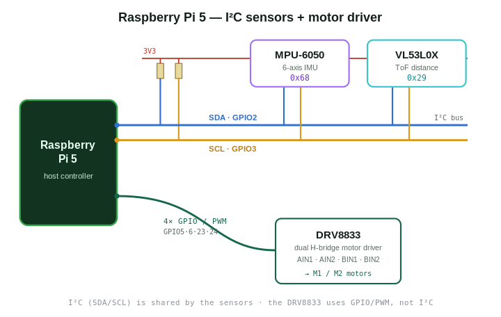

# palmbot-cpp

### Goal
Build a palm-sized autonomous mobile ground robot (*UGV*) from scratch.

### Learning Goals
Learn the different layers of electrical engineering, embedded engineering, and robotics from first principles using theory and lab. Only relying on LLMs for learning, understanding, and strategy with minimal code generation. The project plan was generated by Claude.

### Bill of Materials
[Bill Of Materials](docs/bom.md)

## Phase I
- Raspberry Pi Breadboard bring up of sensors and peripherals
- Create HAL for I2C Bus
- Create drivers for sensors and peripherals:
   - DRV8833
   - MPU6050
   - VL530LX
- Create CAD drawing of palmbot body for 3D printing

#### Learnings
- EE principles and circuits
- Reading data sheets, register maps, and hardware specs
- RAII development
- Heap Profiling
- CMake configuration

#### Diagram
